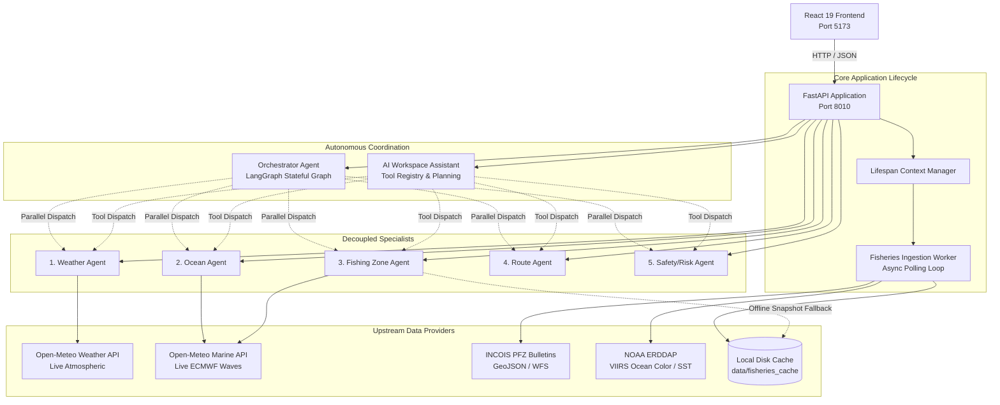
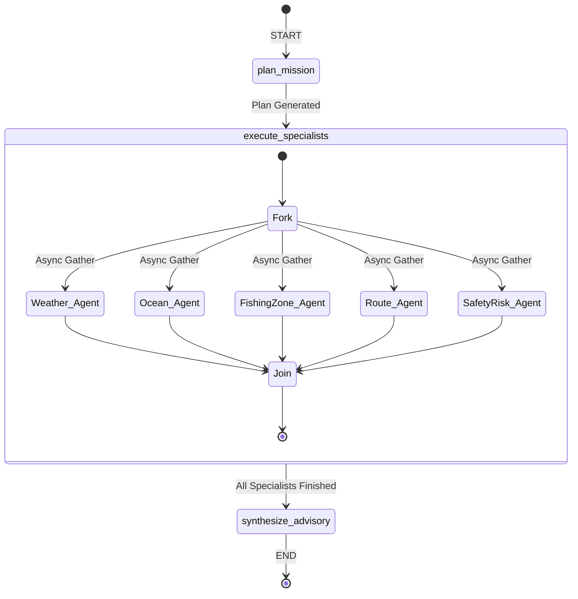

# ORCA Architecture and Data-Flow Specification

This document provides a technical specification of the ORCA Marine Intelligence & Fishing Advisory Platform, detailing component relationships, state schemas, data flows, and scientific grounding mechanisms.

---

## 1. High-Level Architectural Topology

ORCA employs a decoupled multi-agent architecture where specialist agents operate independently while an autonomous workspace assistant and a LangGraph-orchestrated master coordinator synthesize multi-agent intelligence.



---

## 2. Component Directory Structure

```
d:\orca\
├── backend\
│   └── app\
│       ├── agents\
│       │   ├── advisory_generator.py     # Deterministic and LLM advisory synthesis
│       │   ├── assistant_agent.py        # Autonomous Workspace Assistant (Agent 6 Chat)
│       │   ├── fishing_zone_agent.py     # Specialist 3: Fishing Zone & Operability
│       │   ├── ocean_agent.py            # Specialist 2: Wave Physics & WMO Sea State
│       │   ├── orchestrator_agent.py     # Master Orchestrator (LangGraph DAG)
│       │   ├── route_agent.py            # Specialist 4: Geodesic Distance Math
│       │   ├── safety_risk_agent.py      # Specialist 5: Multi-Factor Seaworthiness
│       │   ├── sea_state_rules.py        # WMO Code Table 3700 Douglas Sea Scale
│       │   ├── species_rules.py          # Species thermal habitat registry
│       │   ├── weather_agent.py          # Specialist 1: Atmospheric Observations
│       │   └── tools\
│       │       ├── agent_tools.py        # Tool adapters wrapping specialist agents
│       │       └── tool_registry.py      # Registry for assistant tool execution
│       ├── api\
│       │   ├── router.py                 # Core API router assembly
│       │   └── routes\
│       │       ├── agents\               # Direct routes for all specialist agents
│       │       ├── health.py             # System health check endpoint
│       │       └── marine.py             # Direct wave observations endpoint
│       ├── core\
│       │   └── config.py                 # Pydantic BaseSettings configuration
│       ├── data_sources\
│       │   ├── base.py                   # MarineDataProvider abstract interface
│       │   ├── erddap_client.py          # NOAA ERDDAP client & regional snapshot cache
│       │   ├── incois_pfz.py             # INCOIS PFZ bulletin parser & ray-casting
│       │   ├── ingestion_worker.py       # Asynchronous non-blocking background worker
│       │   ├── open_meteo_marine.py      # Open-Meteo Marine numerical model client
│       │   └── open_meteo_weather.py     # Open-Meteo atmospheric API client
│       ├── evidence\
│       │   ├── freshness.py              # Temporal staleness enforcement policies
│       │   ├── normalizer.py             # EvidenceRecord construction & conversion
│       │   └── validator.py              # Physical plausibility and bounding checks
│       ├── schemas\
│       │   ├── agent_schemas.py          # Pydantic request & response models
│       │   └── evidence.py               # Canonical EvidenceRecord model
│       └── main.py                       # FastAPI application & lifespan manager
├── frontend\
│   ├── src\
│   │   ├── components\
│   │   │   ├── AssistantWorkspace.jsx    # Assistant chat, execution plan, interactive map
│   │   │   ├── FishingZoneSection.jsx    # Fishing Zone Agent UI with data mode badge
│   │   │   ├── OceanSection.jsx          # Ocean Agent UI with WMO sea state meters
│   │   │   ├── RouteSection.jsx          # Route Agent UI with passage breakdown table
│   │   │   ├── SafetyRiskSection.jsx     # Safety Agent UI with gale simulation
│   │   │   └── WeatherSection.jsx        # Weather Agent UI with Beaufort meter
│   │   └── services\
│   │       └── orcaApi.js                # Frontend API client library
│   ├── tests\                            # Node.js live integration and service tests
│   └── scripts\
│       └── run-browser-tests.js          # Headless Chrome CDP automated verification
└── tests\
    ├── fixtures\                         # Verified GeoJSON and ERDDAP table fixtures
    └── unit\                             # 201 backend unit and ingestion tests
```

---

## 3. The Canonical Evidence Contract: `EvidenceRecord`

Every raw observation from any provider is normalized into an immutable, verifiable `EvidenceRecord`:

```python
class EvidenceRecord(BaseModel):
    evidence_id: str                      # Globally unique deterministic record ID
    source: str                           # Provider name (e.g., 'open-meteo-marine')
    source_record_id: str                 # Provider-specific row or feature ID
    variable: str                         # Standardized parameter name ('wave_height', 'sst')
    value: float | int | str | None       # Measured physical value
    unit: str                             # Physical unit ('m', 'degC', 'mg/m^3', 'knots')
    latitude: float | None                # Geographic WGS84 latitude
    longitude: float | None               # Geographic WGS84 longitude
    depth_m: float | None = None          # Depth below surface in meters
    observed_at: datetime | None          # UTC timestamp when physical variable was observed
    retrieved_at: datetime                # UTC timestamp when ORCA retrieved the record
    status: str = "valid"                 # 'valid', 'stale', 'invalid', 'rejected'
    quality_flags: list[str] = []         # Flags ('satellite_remote_sensing', 'cached_offline_snapshot')
    metadata: dict[str, Any] = {}         # Provenance headers, bounding box, sensor IDs
```

### Physical Validation Policies
All incoming records undergo boundary checks before ingestion:
- **Wave Height ($H_s$)**: $0.0 \le H_s \le 30.0$ meters.
- **Sea Surface Temperature (SST)**: $-2.0 \le \text{SST} \le 45.0$ °C.
- **Chlorophyll-*a* ($\text{Chl-a}$)**: $0.0 \le \text{Chl-a} \le 100.0$ $\text{mg/m}^3$.
- **Fish Biomass Density**: $\ge 0.0$ $\text{kg/km}^2$.
- **Wind Speed**: $0.0 \le \text{Wind} \le 150.0$ knots.

Records violating these boundaries or carrying future timestamps (for historical observations) are rejected and logged in the response's `rejected_records` array.

---

## 4. Orchestrator Workflow: LangGraph DAG

The Orchestrator Agent executes as a compiled `StateGraph`:



### LangGraph State Schema (`OrchestratorState`)
- `latitude`, `longitude`, `location_name`: Spatial query coordinates.
- `user_objective`: `'fishing'`, `'passage_planning'`, `'safety_check'`, or `'all'`.
- `planned_agents`: List of specialists selected for execution.
- `specialist_responses`: Raw response dictionary mapping agent names to response payloads.
- `measured_observations`: Reconciled physical observations from contributing providers.
- `derived_estimates`: Calculated geodesic route distances, transit hours, and bounds.
- `warnings`: Accumulated safety notices, observation discrepancies, and offline indicators.

---

## 5. Resilient Fisheries Ingestion Pipeline

### Background Worker Lifecycle
The `FisheriesIngestionWorker` implements non-blocking execution:

```python
@asynccontextmanager
async def lifespan(app: FastAPI):
    worker = None
    if settings.fisheries_ingestion_enabled:
        worker = get_fisheries_worker()
        await worker.start()      # Non-blocking: spawns asyncio.create_task()
    yield
    if worker is not None:
        await worker.stop()       # Structured cancellation with 5.0s timeout
```

### Spatial Bounding Box Containment
Cached NOAA ERDDAP snapshots are evaluated against the requested coordinate:

```python
def find_matching_snapshot(product_id, lat, lon):
    for snap in snapshots:
        if snap.product_id == product_id:
            if snap.min_lat <= lat <= snap.max_lat and snap.min_lon <= lon <= snap.max_lon:
                return snap  # Bounding box match
    return None  # Cache miss: returns [] without fabricating data
```

---

## 6. Navigational Safety & Scientific Disclaimers

1. **Non-Navigable Routes**: Route calculations represent mathematical Great-Circle geodesic distances. They do **not** verify underwater shoals, bathymetric depths, or landmass avoidance.
2. **Strict `INSUFFICIENT_EVIDENCE`**: If direct biological fisheries telemetry is unavailable, ORCA never invents fish coordinates. Favorable wave height evaluates craft operability only.
3. **Absence of Telemetry**: Incomplete or missing marine telemetry is strictly evaluated as `UNKNOWN / INSUFFICIENT EVIDENCE`, never `LOW RISK` or safe.
