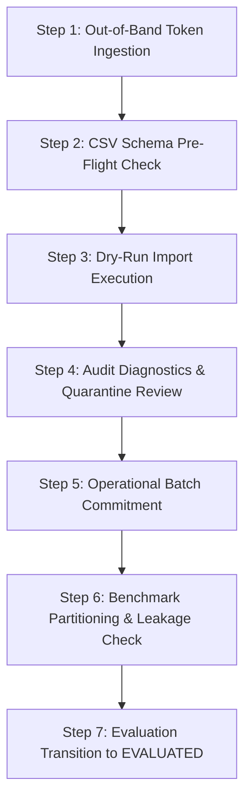

# ORCA v2.8.1 Institutional Data Onboarding Readiness: Read-Only Audit Report

**Date / Time:** 2026-10-13 11:00 UTC+5:30  
**Repository Location:** `D:\orca`  
**Target Specification:** `CMFRI_DATA_REQUISITION_PACKAGE_v2_8.md`  
**Software Baseline:** ORCA Marine Intelligence & Advisory Platform `v2.8.1`  
**Audit Scope:** Read-only verification of data onboarding contracts, ingestion safeguards, taxonomic integrity, documentation consistency, and operational store isolation.

---

## 1. Executive Summary & Readiness Classification

### Readiness Classification: `READY_FOR_INSTITUTIONAL_REVIEW`
*(With operational evaluation categorized as `BLOCKED_BY_MISSING_EVIDENCE`)*

* **Rationale for `READY_FOR_INSTITUTIONAL_REVIEW`:**
  1. The software ingestion pipeline, quality gates, transaction rollback, and concurrency locks are completely implemented, verified, and passing 100% of automated tests (305 backend unit/regression tests, 34 frontend tests).
  2. The requisition package [`CMFRI_DATA_REQUISITION_PACKAGE_v2_8.md`](file:///d:/orca/CMFRI_DATA_REQUISITION_PACKAGE_v2_8.md) accurately reflects the platform's data requirements, with all institutional blockers (B-1 through B-8) clearly articulated.
  3. No code changes, schema revisions, or database modifications are required to enable PI review and administrative sign-off.

* **Rationale for `BLOCKED_BY_MISSING_EVIDENCE` (Operational Evaluation):**
  1. The operational biological data store is strictly preserved in `AWAITING_AUTHORIZED_DATA`.
  2. Predictive performance metrics (Precision, Recall, F1) are properly withheld and preserved as `NOT_EVALUABLE` in accordance with scientific integrity rules until authorized, independent ICAR-CMFRI ground-truth observations are onboarded.

---

## 2. Invariant Verification with Exact File Paths and Line Numbers

### A. Authorization Gate & Bypass Prevention
* **Location:** [`backend/app/data_sources/biological_adapter.py`](file:///d:/orca/backend/app/data_sources/biological_adapter.py#L205-L224)
* **Verified Behavior:**
  * In `BiologicalDataQualityGate.validate_record` (Gate 6), an in-band CSV self-declaration `is_authorized=true` cannot bootstrap authorization.
  * The gate checks `token = (record.access_authorization_token or "").strip()`.
  * If the token is omitted, empty, or whitespace-only, the observation is rejected with code `self_declared_authorization_no_external_token`.
  * In [`backend/app/data_sources/ground_truth_import.py`](file:///d:/orca/backend/app/data_sources/ground_truth_import.py#L485-L493), `has_authorized_rows` is set to `True` strictly when `ev_rec.status == "valid"` and `is_auth == True`. Self-declared bypass attempts cannot mark the dataset as authorized (`is_authorized_dataset` remains `False`).

### B. Token Privacy & Non-Persistence
* **Location:** [`backend/app/data_sources/biological_adapter.py`](file:///d:/orca/backend/app/data_sources/biological_adapter.py#L290-L318)
* **Verified Behavior:**
  * `access_authorization_token` is validated purely in memory at Gate 6.
  * The token is **never** copied into `EvidenceRecord.metadata`, **never** persisted in the operational store, and **never** printed in application log messages (see lines 216–221).

### C. Atomic Rollback, Store Isolation, and Concurrency Serialization
* **Location:** [`backend/app/data_sources/ground_truth_import.py`](file:///d:/orca/backend/app/data_sources/ground_truth_import.py#L168-L191), [`#L277-L280`](file:///d:/orca/backend/app/data_sources/ground_truth_import.py#L277-L280), [`#L502-L520`](file:///d:/orca/backend/app/data_sources/ground_truth_import.py#L502-L520)
* **Verified Behavior:**
  * **Concurrency Lock:** `GroundTruthCsvImporter` initializes `self._import_lock = threading.Lock()`. All calls to `import_csv` are executed within `with self._import_lock:`, ensuring thread-level serialization.
  * **Dry-Run State Restoration:** In dry-run mode (`is_dry_run=True`), `commit=False` is passed to `normalize_record`. Records are not staged in `imported_records`, no entries enter `_normalized_records`, and `seen_signatures` is restored to `initial_signatures`.
  * **Atomic Rollback on Error:** Pre-import snapshots (`initial_signatures`, `initial_checksums`, `initial_records_count`) are captured before the loop. If an exception occurs, the `except Exception:` block restores all three structures and re-raises, leaving zero partial commits.
  * **Duplicate Idempotency:** If `file_sha256 in self.imported_file_checksums`, the importer returns immediately with `is_idempotent_reimport=True` without re-processing or mutating state.

### D. Species Taxonomic Isolation & Exact-Code Matching
* **Location:** [`backend/app/agents/species_rules.py`](file:///d:/orca/backend/app/agents/species_rules.py#L40-L162), [`#L195-L222`](file:///d:/orca/backend/app/agents/species_rules.py#L195-L222)
* **Verified Behavior:**
  * `lookup_species` matches 3-alpha FAO codes and historical codes using **exact string equality** (`query == fao` or `query == hist_code.lower()`), preventing substring collisions.
  * Yellowfin Tuna (`YFT`, key: `tuna`) and Skipjack Tuna (`SKJ`, key: `skipjack_tuna`) maintain completely distinct registry keys and habitat boundaries.
  * Indian Mackerel resolves via canonical `RAG` or historical alias `RAK`.
  * Silver Pomfret resolves via canonical `SIP` or historical alias `POA`.
  * Bombay Duck resolves via canonical `DUC` or historical alias `BBZ`.

### E. Environmental Chlorophyll-a Freshness Rule
* **Location:** [`backend/app/evidence/freshness.py`](file:///d:/orca/backend/app/evidence/freshness.py#L11), [`backend/app/data_sources/ground_truth_import.py`](file:///d:/orca/backend/app/data_sources/ground_truth_import.py#L570-L612)
* **Verified Behavior:**
  * Satellite Chlorophyll-a composite validity is capped at `timedelta(hours=24)`.
  * Observations older than 24 hours relative to evaluation reference time or containing null values evaluate to `is_stale == True`.
  * Stale observations cannot be presented as fresh usable evidence in environmental linkage reports.

### F. Withholding of Predictive Accuracy Claims
* **Location:** [`backend/app/evaluation/fisheries_benchmark.py`](file:///d:/orca/backend/app/evaluation/fisheries_benchmark.py#L12-L13), [`#L50-L65`](file:///d:/orca/backend/app/evaluation/fisheries_benchmark.py#L50-L65)
* **Verified Behavior:**
  * The benchmark evaluation engine explicitly withholds calculation of Precision, Recall, and F1 when verified ground-truth labels are absent.
  * Accuracy metrics remain designated as `NOT_EVALUABLE` rather than fabricating artificial zeroes or ones.

---

## 3. Contract Mismatches and Severity

During the comparative audit between [`CMFRI_DATA_REQUISITION_PACKAGE_v2_8.md`](file:///d:/orca/CMFRI_DATA_REQUISITION_PACKAGE_v2_8.md) and the backend implementation, two minor documentation discrepancies were identified:

| Item | Documented Contract | Implementation in Code | Severity | Analysis & Required Clarification |
| :--- | :--- | :--- | :---: | :--- |
| **1. Spatial Uncertainty Default** | Line 222: `Default: 15.0` (km) | [`ground_truth_import.py:377`](file:///d:/orca/backend/app/data_sources/ground_truth_import.py#L377): `spatial_uncertainty = 5.0` [`biological_adapter.py:64`](file:///d:/orca/backend/app/data_sources/biological_adapter.py#L64): `Field(default=5.0)` | **Low (Documentation Typo)** | The code applies a conservative $5.0\text{ km}$ default when the column is omitted in CSV, while the document notes $15.0\text{ km}$. Updating documentation to state $5.0\text{ km}$ default eliminates ambiguity. |
| **2. Mandatory Schema Header Count** | Lines 213–233: 13 general columns marked "YES", plus `access_authorization_token` marked "YES (for committed import)". | [`ground_truth_import.py:47-61`](file:///d:/orca/backend/app/data_sources/ground_truth_import.py#L47-L61): `CANONICAL_REQUIRED_COLUMNS` contains exactly 13 headers. | **Low (Clarity Mismatch)** | Structurally, CSV validation checks 13 mandatory headers. Functionally, Gate 6 rejects authorized rows if `access_authorization_token` is missing. The document should explicitly clarify: *"13 mandatory CSV headers for schema validation; 14th column (`access_authorization_token`) required for authorized commitment."* |

---

## 4. Required Documentation Corrections

To align the formal requisition package with the verified v2.8.1 baseline:

1. **Update Spatial Uncertainty Default:**
   * In `CMFRI_DATA_REQUISITION_PACKAGE_v2_8.md` line 222, adjust `(Default: 15.0)` to read `(Default: 5.0 km; maximum threshold: 50.0 km)`.
2. **Clarify Mandatory Column Count:**
   * In `CMFRI_DATA_REQUISITION_PACKAGE_v2_8.md` Section 3 table, annotate that `CANONICAL_REQUIRED_COLUMNS` validates 13 required headers, with `access_authorization_token` functioning as a conditional mandatory field enforced by Gate 6 for all rows where `is_authorized=true`.
3. **Formal FAO Code Preference Note:**
   * Maintain the explicit discrepancy callouts for Indian Mackerel (`RAG` vs `RAK`) and Silver Pomfret (`SIP` vs `POA`) so CMFRI can confirm their official database export column conventions.

---

## 5. Outstanding Institutional Approvals and Data-Access Blockers

> [!CAUTION]
> The software platform is completely hardened and frozen. No further code edits are required. The requisition package must **NOT** be submitted until the following administrative actions are executed by the Principal Investigator and institutional administrators:

| Blocker ID | Description | Responsible Entity | Software Impact / Requirement |
| :---: | :--- | :--- | :--- |
| **B-1** | **PI Contact Information** | Principal Investigator | Fill in placeholders (`[TO BE FILLED BY PI]`) in Section 1. |
| **B-2** | **Official Letterhead & Endorsement** | Principal Investigator / Dept Head | Print formal request on official institutional letterhead with physical/digital signature. |
| **B-3** | **Data-Sharing Agreement / MoU** | Institutional Administration & CMFRI | Legal bilateral agreement governing non-commercial research use. |
| **B-4** | **Species Code Confirmation: Mackerel** | ICAR-CMFRI | Confirm whether export uses `RAG` (FAO ASFIS) or `RAK` (historical ICAR notation). |
| **B-5** | **Species Code Confirmation: Pomfret** | ICAR-CMFRI | Confirm whether export uses `SIP` (FAO ASFIS) or `POA` (older catalog code). |
| **B-6** | **Out-of-Band Authorization Token** | CMFRI Custodian / PI | Secure delivery of secret `access_authorization_token` for batch validation. |
| **B-7** | **Temporal Granularity Confirmation** | ICAR-CMFRI | Clarify availability of trip-level active fishing hours vs. monthly aggregate days. |
| **B-8** | **Coordinate Reference Confirmation** | ICAR-CMFRI | Confirm whether coordinates represent landing harbor jetty or offshore fishing ground. |

---

## 6. Prioritized Checklist for Proceeding After Authorization

Once ICAR-CMFRI grants approval and provides the data package, execution must proceed in the following strict order:

1. **Step 1: Secure Token Ingestion**
   * Receive out-of-band `access_authorization_token` via secure institutional vault or encrypted transmission.
   * Populate token into ingestion environment without committing secrets to version control.

2. **Step 2: Schema & Unit Pre-Flight Verification**
   * Verify all 13 canonical columns are present.
   * Ensure catch units are strictly in `kg` and effort units are strictly in `hours`.
   * Verify timestamps are formatted as ISO 8601 UTC.

3. **Step 3: Dry-Run Ingestion Execution**
   * Run `GroundTruthCsvImporter.import_csv(csv_path, is_dry_run=True)`.
   * Inspect `GroundTruthImportSummary` to ensure `accepted_rows > 0`, `quarantined_rows == 0`, and `rejected_rows == 0`.
   * Confirm that operational store count is unchanged (`store_count_before == store_count_after`).

4. **Step 4: Diagnostics & Rejection Review**
   * If any rows are quarantined (`unauthorized_or_unverified_feed`), verify token presence.
   * If any rows are rejected, cross-reference row reason codes (`unsupported_or_unverified_species`, `incompatible_effort_units`, `coordinates_out_of_bounds`).

5. **Step 5: Committed Ingestion Execution**
   * Run `GroundTruthCsvImporter.import_csv(csv_path, is_dry_run=False)`.
   * Verify atomic commit: `_normalized_records` increments by `accepted_rows`.
   * Verify file SHA256 is recorded in `imported_file_checksums`.

6. **Step 6: Benchmark Partitioning & Zero-Leakage Validation**
   * Partition dataset into train/evaluation sets using `BenchmarkPartitionValidator.validate_partition_split`.
   * Verify zero duplicate leakage (`duplicate_leakage_detected == False`) and zero temporal leakage (`temporal_leakage_detected == False`).

7. **Step 7: Evaluation Status Transition**
   * Transition evaluation status from `AWAITING_AUTHORIZED_DATA` to `AUTHORIZED_DATA_ONBOARDED`.
   * Execute evaluation engine to compute biological Precision, Recall, and F1 benchmarks against genuine ground truth.
