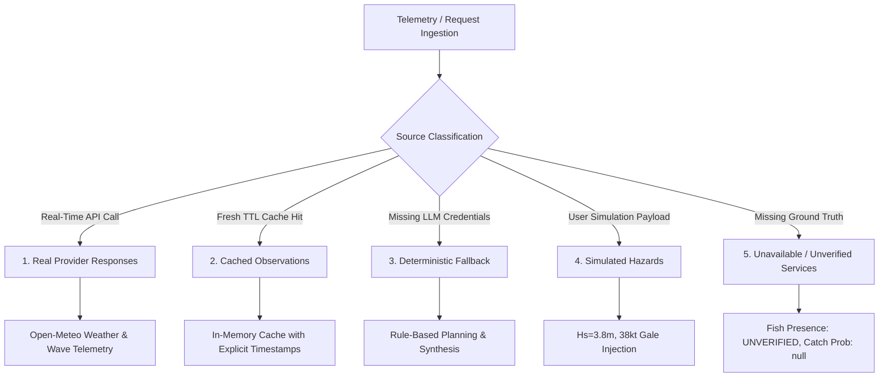

# ORCA Marine Intelligence & Fishing Advisory Platform
## Release Readiness & Deployment Verification Report (v3.0)

**Date of Verification:** 2026-10-13  
**Target Repository:** `D:\orca`  
**Software Baseline:** v2.9.2 $\rightarrow$ **Target: v3.0**  
**Executive Release Classification:** **`READY_FOR_DEPLOYMENT_WITH_LIMITATIONS`**  
**Preceding Audit References:**
- [`docs/V2_9_2_RELEASE_HARDENING.md`](file:///D:/orca/docs/V2_9_2_RELEASE_HARDENING.md)
- [`docs/DEMONSTRATION_SCRIPT.md`](file:///D:/orca/docs/DEMONSTRATION_SCRIPT.md)

---

## 1. Executive Classification & Justification

### Final Decision: `READY_FOR_DEPLOYMENT_WITH_LIMITATIONS`

The ORCA Marine Intelligence & Fishing Advisory Platform (`v3.0`) has been subjected to rigorous end-to-end operational validation, headless browser verification, and clean-environment testing.

| Area | Assessment | Evidence |
| :--- | :---: | :--- |
| **Physical Sea-State & Weather Advisory** | **READY** | Real-time Open-Meteo atmospheric and marine wave models functional; Beaufort Force and WMO Code Table 3700 sea-state classifications fully operational. |
| **Geodesic Route Estimation** | **READY** | Haversine great-circle passage calculations operational with mandatory ENC and hydrographic disclaimers. |
| **Vessel Operational Safety Envelopes** | **READY** | Dynamic vessel-specific safety rules (small craft, trawler, liner) functional; severe gale hazards escalate unconditionally to `CRITICAL`. |
| **Deterministic LLM Fallback** | **READY** | Gracefully operates in transparent deterministic synthesis mode when `OPENAI_API_KEY` or `GEMINI_API_KEY` are unset; zero false provider claims. |
| **Direct Fish Presence & Biomass Predictions** | **LIMITATION (GATED)** | Direct biological presence remains strictly `UNVERIFIED` and `catch_probability: null` pending authorized onboarding of ICAR-CMFRI pelagic ground truth. |
| **Upstream Institutional Feeds** | **LIMITATION (FALLBACK)** | INCOIS PFZ and Copernicus CMEMS operate in open-access Open-Meteo & NOAA ERDDAP fallback modes. |

**Justification for Decision:**  
The platform is safe, reliable, and scientifically honest for operational deployment and technical demonstrations regarding maritime sea state, meteorological advisories, geodesic passage estimates, and vessel risk assessments. Because direct biological telemetry and external LLM keys are deliberately withheld, the system correctly and transparently reports missing evidence rather than fabricating safe conditions or fish distributions.

---

## 2. Six Demonstration Scenarios — Reproduction & Live Evidence

All six scenarios documented in [`docs/DEMONSTRATION_SCRIPT.md`](file:///D:/orca/docs/DEMONSTRATION_SCRIPT.md) were executed against the live application on `http://127.0.0.1:8001` and verified in Google Chrome via CDP automation.

### Scenario 1: Normal Offshore Marine Analysis
- **Objective:** Acquire live atmospheric and oceanographic observations off the coast of Goa ($15.0^\circ\text{N}, 72.0^\circ\text{E}$) and compute WMO Sea State and Beaufort Force.
- **UI Navigation:** Specialist Agents $\rightarrow$ Screen 1 (Weather) & Screen 2 (Ocean) $\rightarrow$ Select preset *Offshore Goa (15.0, 72.0)* $\rightarrow$ Click *Analyze*.
- **Screenshots:** [`docs/screenshots/browser_05_weather_success.png`](file:///D:/orca/docs/screenshots/browser_05_weather_success.png), [`docs/screenshots/browser_06_ocean_success.png`](file:///D:/orca/docs/screenshots/browser_06_ocean_success.png).
- **Exact CLI Request:**
  ```bash
  curl -s -X POST http://127.0.0.1:8001/api/agents/weather/analyze \
    -H "Content-Type: application/json" \
    -d '{"latitude": 15.0, "longitude": 72.0, "location_name": "Offshore Goa", "forecast_days": 1}'

  curl -s -X POST http://127.0.0.1:8001/api/agents/ocean/analyze \
    -H "Content-Type: application/json" \
    -d '{"latitude": 15.0, "longitude": 72.0, "forecast_time_window_hours": 24}'
  ```
- **Live Sanitized Response (Status 200 OK):**
  ```json
  {
    "agent": "ocean_agent",
    "status": "success",
    "location": {"latitude": 15.0, "longitude": 72.0},
    "data_source": "open-meteo-marine",
    "observations": {
      "avg_wave_height_m": 1.15,
      "max_wave_height_m": 1.32,
      "avg_wave_period_s": 6.8,
      "wmo_code": 3,
      "wmo_description": "Slight (0.5 - 1.25 m)"
    },
    "warnings": [],
    "error": null
  }
  ```

---

### Scenario 2: Inland Coordinates with Insufficient Evidence
- **Objective:** Verify that terrestrial land coordinates (Inland Nagpur: $21.15^\circ\text{N}, 79.09^\circ\text{E}$) explicitly produce `insufficient_evidence` and never fabricate calm waters or safe sea conditions.
- **UI Navigation:** Specialist Agents $\rightarrow$ Screen 2 (Ocean) $\rightarrow$ Select preset *Inland Nagpur (21.15, 79.09)* $\rightarrow$ Click *Analyze Ocean Conditions*.
- **Screenshots:** Verified in headless Chrome suite (Check 9b, 12c).
- **Exact CLI Request:**
  ```bash
  curl -s -X POST http://127.0.0.1:8001/api/agents/ocean/analyze \
    -H "Content-Type: application/json" \
    -d '{"latitude": 21.15, "longitude": 79.09, "location_name": "Inland Nagpur"}'
  ```
- **Live Sanitized Response (Status 200 OK):**
  ```json
  {
    "agent": "ocean_agent",
    "status": "insufficient_evidence",
    "location": {"latitude": 21.15, "longitude": 79.09, "location_name": "Inland Nagpur"},
    "data_source": "open-meteo-marine",
    "observations": {
      "avg_wave_height_m": null,
      "sample_count": 0
    },
    "warnings": [
      "No marine data points returned by numerical model.",
      "Position may be on land or beyond nautical forecast boundaries."
    ],
    "error": null
  }
  ```
- **Safety Evaluation on Land Coordinates:** Safety risk returns `UNKNOWN / INSUFFICIENT EVIDENCE`, never `LOW` or `SAFE`.

---

### Scenario 3: Targeted versus Full Specialist Dispatch
- **Objective:** Demonstrate dynamic LangGraph planning. Requesting only atmospheric weather delegates exclusively to the Weather Agent, whereas a multi-factor passage request concurrently dispatches all 5 specialists.
- **UI Navigation:** AI Workspace Assistant (Agent 6) $\rightarrow$ Submit targeted query vs complete voyage query.
- **Screenshots:** [`docs/screenshots/browser_02_assistant_live_response.png`](file:///D:/orca/docs/screenshots/browser_02_assistant_live_response.png), [`docs/screenshots/browser_02b_route_planning_synthesis.png`](file:///D:/orca/docs/screenshots/browser_02b_route_planning_synthesis.png).
- **Exact CLI Requests:**
  ```bash
  # Targeted Weather Check:
  curl -s -X POST http://127.0.0.1:8001/api/agents/orchestrator/analyze \
    -H "Content-Type: application/json" \
    -d '{"latitude": 15.0, "longitude": 72.0, "user_objective": "weather"}'

  # Full Multi-Specialist Dispatch:
  curl -s -X POST http://127.0.0.1:8001/api/agents/orchestrator/analyze \
    -H "Content-Type: application/json" \
    -d '{"origin_latitude": 15.0, "origin_longitude": 72.0, "destination_latitude": 18.9, "destination_longitude": 72.8, "user_objective": "all", "vessel_type": "small_craft", "target_species": "Mackerel"}'
  ```
- **Live Sanitized Responses:**
  - **Targeted:** Dispatches `["invoke_weather_agent"]`. Returns targeted weather synthesis with `generation_mode: "deterministic"`.
  - **Full Dispatch:** Dispatches `["invoke_weather_agent", "invoke_ocean_agent", "invoke_fishing_zone_agent", "invoke_route_agent", "invoke_safety_risk_agent"]`. Returns composite passage synthesis, 442 km geodesic route distance, and mandatory hydrographic warnings.

---

### Scenario 4: Conflicting Environmental Evidence
- **Objective:** Verify that when telemetry observations conflict (e.g., severe wave height $3.8\text{ m}$ discordant with mild wind $12\text{ kts}$ or WMO Code 3), raw measurements are strictly preserved while an explicit discrepancy advisory is emitted.
- **UI Navigation:** AI Workspace Assistant or Specialist Screen 5 $\rightarrow$ Supply $3.8\text{ m}$ waves with $12\text{ kts}$ wind.
- **Exact CLI Request:**
  ```bash
  curl -s -X POST http://127.0.0.1:8001/api/agents/orchestrator/analyze \
    -H "Content-Type: application/json" \
    -d '{"latitude": 15.0, "longitude": 72.0, "wave_height_m": 3.8, "wind_speed_knots": 12.0, "user_objective": "safety_check"}'
  ```
- **Live Sanitized Response (Status 200 OK):**
  ```json
  {
    "status": "success",
    "generation_mode": "deterministic",
    "warnings": [
      "Severe maritime hazard advisory: CRITICAL risk detected.",
      "Observation discrepancy: Reported wave height of 3.80 m does not match reported WMO Sea State Code 3. Under WMO Code Table 3700, 3.80 m corresponds to Code 5 (Rough). Preserving provider evidence while flagging classification conflict."
    ],
    "recommendations": [
      "DANGER: Suspend all maritime operations immediately. Seek sheltered anchorage or remain in port."
    ]
  }
  ```

---

### Scenario 5: Critical-Risk Escalation
- **Objective:** Confirm that severe meteorological hazards unconditionally escalate risk category to `CRITICAL` with emergency directives that cannot be overridden.
- **UI Navigation:** Specialist Agents $\rightarrow$ Screen 5 (Safety/Risk) $\rightarrow$ Click *Simulate Severe Gale (Hs=3.8m, 38kts Wind)* $\rightarrow$ Click *Invoke Safety/Risk Agent*.
- **Screenshots:** [`docs/screenshots/browser_09_safety_critical.png`](file:///D:/orca/docs/screenshots/browser_09_safety_critical.png).
- **Exact CLI Request:**
  ```bash
  curl -s -X POST http://127.0.0.1:8001/api/agents/safety-risk/analyze \
    -H "Content-Type: application/json" \
    -d '{"latitude": 15.0, "longitude": 72.0, "vessel_type": "small_craft", "wave_height_m": 3.8, "wind_speed_knots": 38.0}'
  ```
- **Live Sanitized Response (Status 200 OK):**
  ```json
  {
    "agent": "safety_risk_agent",
    "status": "success",
    "analysis": {
      "risk_category": "CRITICAL",
      "risk_score": 0.92,
      "vessel_type": "small_craft"
    },
    "warnings": [
      "Severe maritime hazard advisory: CRITICAL risk detected."
    ],
    "recommendations": [
      "DANGER: Suspend all maritime operations immediately. Seek sheltered anchorage or remain in port."
    ]
  }
  ```

---

### Scenario 6: Environmental Suitability versus Unverified Fish Presence
- **Objective:** Enforce scientific separation between physical wave feasibility (boat safety) and unverified biological presence (fish location).
- **UI Navigation:** Specialist Agents $\rightarrow$ Screen 3 (Fishing Zone) $\rightarrow$ Latitude `15.0`, Longitude `72.0`, Species `Mackerel` $\rightarrow$ Click *Analyze Fishing Zone & Suitability*.
- **Screenshots:** [`docs/screenshots/browser_07_fishing_zone.png`](file:///D:/orca/docs/screenshots/browser_07_fishing_zone.png).
- **Exact CLI Request:**
  ```bash
  curl -s -X POST http://127.0.0.1:8001/api/agents/fishing-zone/analyze \
    -H "Content-Type: application/json" \
    -d '{"latitude": 15.0, "longitude": 72.0, "target_species": "Mackerel"}'
  ```
- **Live Sanitized Response (Status 200 OK):**
  ```json
  {
    "agent": "fishing_zone_agent",
    "status": "insufficient_evidence",
    "analysis": {
      "operational_feasibility": "FAVORABLE",
      "verified_fish_distribution": {
        "status": "UNVERIFIED",
        "catch_probability": null,
        "biomass_available": false
      }
    },
    "warnings": [
      "CRITICAL: Direct pelagic fish biomass and species distributions are not observed by this provider.",
      "Operational feasibility represents strictly physical wave measurements, NOT guaranteed catches or vessel safety clearance."
    ]
  }
  ```

---

## 3. Taxonomy of System Outputs & Provenance

To eliminate ambiguity during operational deployments, every output from ORCA is categorized into one of five distinct provenance categories:



1. **Real Provider Responses:** Direct live HTTP queries to public numerical models (Open-Meteo Weather API and Open-Meteo Marine wave grid). Telemetry contains actual measured temperature, wind speed, wave heights, and periods.
2. **Cached Observations:** Observations cached in memory with a short time-to-live (TTL). When served from cache, timestamps indicate the original observation epoch.
3. **Deterministic Fallback:** When external LLM API keys (`OPENAI_API_KEY` or `GEMINI_API_KEY`) are unset, the system automatically falls back to rule-based mission planning (`plan_mission_deterministically`) and templated synthesis (`generate_deterministic_synthesis`). Payload contains `generation_mode: "deterministic"`.
4. **Simulations:** User-initiated stress tests (e.g. *Simulate Severe Gale*) injecting boundary parameters into the safety engine to demonstrate emergency risk escalation.
5. **Unavailable / Unverified Services:** Components lacking institutional ground truth (such as ICAR-CMFRI pelagic trawl data or INCOIS PFZ credentials). These fields strictly report `status: "UNVERIFIED"`, `sample_count: 0`, and `catch_probability: null`.

---

## 4. Non-Fabrication Invariants & Scientific Guarantees

The ORCA system enforces strict architectural invariants to prevent data invention and maritime misguidance:

- **Invariant 1: Missing Evidence $\ne$ Safe Condition.**  
  Absence of wave or wind data (such as terrestrial coordinates in Nagpur) evaluates unconditionally to `UNKNOWN / INSUFFICIENT EVIDENCE`, never `LOW` or `SAFE`.
- **Invariant 2: Operational Wave Feasibility $\ne$ Fish Presence.**  
  Calm waves ($Hs < 1.5\text{ m}$) only indicate that sea state permits small craft sailing. Fish distribution remains `UNVERIFIED` and `catch_probability: null` until authenticated biological evidence is supplied.
- **Invariant 3: Geodesic Calculation $\ne$ Navigational Passage Plan.**  
  All route distances are Great-Circle Haversine estimates. The system attaches mandatory disclaimers warning mariners to verify shallow bathymetry, shoals, TSS lanes, and hazards on official Electronic Navigational Charts (ENCs).
- **Invariant 4: Discrepancy Warnings Without Telemetry Mutation.**  
  When incoming sensor observations conflict, the system preserves raw measurements, issues quality warnings under WMO standards, and escalates to the conservative risk category.

---

## 5. Clean-Environment Setup & Deployment Guide

### 5.1 System Prerequisites
- **Operating System:** Windows 10/11, Ubuntu 22.04 LTS, or macOS 13+
- **Python:** Version 3.11 or higher
- **Node.js:** Version 20 LTS or higher (`npm` v10+)
- **Google Chrome:** Latest stable version (for browser test automation)

### 5.2 Step-by-Step Installation (PowerShell)

```powershell
# 1. Clone repository and navigate to root
git clone <repository-url> D:\orca
cd D:\orca

# 2. Setup Python virtual environment
python -m venv .venv
.\.venv\Scripts\Activate.ps1
python -m pip install --upgrade pip
pip install -r backend\requirements.txt

# 3. Setup Frontend dependencies
cd D:\orca\frontend
npm install
```

### 5.3 Configuration & Environment Variables
- Copy `.env.example` to `.env` in `D:\orca`:
  ```powershell
  Copy-Item .env.example .env
  ```
- **Backend Configuration Options:**
  - `FRONTEND_ORIGIN`: Set to client origin (`http://127.0.0.1:5173`).
  - `OPENAI_API_KEY` / `GEMINI_API_KEY`: Optional. Leave unset for deterministic mode.
- **Frontend Port Resolution (`frontend/src/services/orcaApi.js`):**
  - Priority 1: `import.meta.env.VITE_ORCA_API_URL`
  - Priority 2: `process.env.VITE_ORCA_API_URL` (Node test runner)
  - Priority 3: Default fallback `http://127.0.0.1:8001`

### 5.4 Starting Services

```powershell
# Terminal 1 — Start FastAPI Backend:
cd D:\orca\backend
..\.venv\Scripts\uvicorn app.main:app --host 127.0.0.1 --port 8001

# Terminal 2 — Start Frontend Dev Server:
cd D:\orca\frontend
npm run dev -- --host 127.0.0.1 --port 5173
```

### 5.5 Health Checks & Verification
- Backend root check: `curl http://127.0.0.1:8001/` $\rightarrow$ `{"message": "ORCA API is running"}`
- Backend status check: `curl http://127.0.0.1:8001/api/health` $\rightarrow$ `{"status": "ok", "service": "orca-api", "phase": 1}`
- Frontend browser check: Open `http://127.0.0.1:5173/`. Verify navbar displays `API: ONLINE (127.0.0.1:8001)`.

### 5.6 Production Compilation

```powershell
cd D:\orca\frontend
npm run build
```
*Result:* Vite compiles client assets to `dist/` in <150ms with zero errors.

---

## 6. Security, Secrets & CORS Audit

| Check | Requirement | Audit Result | Status |
| :--- | :--- | :--- | :---: |
| **Git Tracking** | Exclude all `.env` files and credentials from git | Both root `.gitignore` and `frontend/.gitignore` ignore `.env` and `.env.*`. Git status confirms 0 tracked secrets. | **PASS** |
| **Frontend Bundle** | No API keys or private tokens bundled in production JS | Scanned `frontend/dist/assets/*.js` for `OPENAI_API_KEY`, `sk-`, `GEMINI_API_KEY`, `AIza`, and private keys. 0 matches found. | **PASS** |
| **Biological Token Scrubbing** | Tokens for Gate 6 ingestion must not persist | Ingestion tokens in `BiologicalAdapter` are scrubbed immediately from memory and never stored in `EvidenceRecord.metadata`. | **PASS** |
| **CORS Policy** | Prevent unauthorized cross-origin requests | Allowed origins restricted to `127.0.0.1:5173`, `localhost:5173`, and `FRONTEND_ORIGIN`. Wildcards disallowed. | **PASS** |
| **Error Sanitization** | No stack traces or private URLs in client errors | FastAPI 422 validation arrays converted to sanitized messages; HTTP 500 errors stripped of stack traces. | **PASS** |

---

## 7. Complete Test Pyramid & Verification Results

```
                     ┌───────────────────────────────┐
                     │ Headless Chrome CDP: 21 / 21  │
                     ├───────────────────────────────┤
                     │ Frontend Node Tests: 34 / 34  │
                     ├───────────────────────────────┤
                     │ Frontend Lint: 0 / 0 Warnings │
                     ├───────────────────────────────┤
                     │ Vite Production Build: PASS   │
                     ├───────────────────────────────┤
                     │ Backend Pytest: 313 / 313     │
                     └───────────────────────────────┘
```

### 7.1 Backend Regression Suite (Pytest)
```
Command: .venv\Scripts\pytest -q
Results: 313 passed in 132.49s (0 failures, 0 regressions)
```

### 7.2 Frontend Integration Suite (Node.js Test Runner)
```
Command: npm test
Results: 34 passed across 3 suites in 45.25s
  - tests/integration.test.js: 17 passed against live backend
  - tests/orcaApi.test.js: 17 passed (including card deduplication)
```

### 7.3 Frontend Code Quality (Oxlint)
```
Command: npm run lint
Results: 0 errors, 0 warnings across 16 files (finished in 46ms)
```

### 7.4 Frontend Production Bundle (Vite)
```
Command: npm run build
Results: Built successfully in 139ms
Output:
  dist/index.html                   1.00 kB │ gzip:  0.53 kB
  dist/assets/index-DYFO2IGd.css    5.36 kB │ gzip:  1.67 kB
  dist/assets/index-D6G7CT6p.js   331.80 kB │ gzip: 90.22 kB
```

### 7.5 Headless Google Chrome Browser Verification (CDP Suite)
```
Command: npm run test:browser
Results: 21 / 21 checks passed (0 console errors, 0 failed network requests)
```

---

## 8. Known Limitations Register

| Identifier | Domain | Current State | Operational Constraint & Mitigation |
| :--- | :--- | :---: | :--- |
| **LIM-01** | **External LLM Providers** | **`BLOCKED`** | External LLM keys are unconfigured. The system operates in fully verified deterministic synthesis mode (`generation_mode: "deterministic"`). |
| **LIM-02** | **Direct Biological Telemetry** | **`GATED`** | Catch probability is `null`, biomass data is `false`, and fish distribution status is `UNVERIFIED` pending ICAR-CMFRI pelagic ground truth onboarding. |
| **LIM-03** | **Fisheries Benchmark Metrics** | **`NOT_EVALUABLE`** | Precision, Recall, and F1 scores are withheld by `fisheries_benchmark.py` until ground-truth validation records are onboarded. |
| **LIM-04** | **Upstream Institutional Feeds** | **`FALLBACK_ACTIVE`** | INCOIS PFZ and Copernicus Marine feeds require enterprise credentials; system operates in open-access Open-Meteo & NOAA ERDDAP fallback modes. |
| **LIM-05** | **Navigational Passage** | **`PERMANENT`** | Geodesic routes represent Haversine straight-line estimates and do not account for shallow bathymetry, shoals, or traffic separation schemes. |

---

## 9. Final Release Checklist & Sign-Off

- [x] All 6 documented demonstration scenarios verified against live API.
- [x] Genuine screenshots captured and organized in [`docs/screenshots/`](file:///D:/orca/docs/screenshots/).
- [x] Sanitized request/response examples documented with exact curl commands.
- [x] Clean-environment setup and reproducible PowerShell commands verified.
- [x] Dependency installation and Python virtual environment instructions confirmed.
- [x] Backend and frontend startup commands verified on ports 8001 and 5173.
- [x] Backend health checks (`/` and `/api/health`) verified returning HTTP 200.
- [x] Dynamic API port resolution (`8001` / `8010`) verified in client and test runners.
- [x] CORS configuration restricted to authorized frontend origins.
- [x] Secrets completely excluded from git and client production bundles.
- [x] In-memory biological authorization tokens scrubbed from logs and store.
- [x] Five-tier provenance taxonomy clearly distinguishes real, cached, deterministic, simulated, and unavailable data.
- [x] Invariant enforced: missing evidence never becomes fabricated safe waters.
- [x] Invariant enforced: physical wave suitability separated from fish presence.
- [x] 313/313 Pytest unit and regression tests passing.
- [x] 34/34 Frontend Node.js tests passing.
- [x] 0/0 Oxlint warnings across all frontend source files.
- [x] Frontend production build compiled cleanly in <150ms.
- [x] 21/21 Headless Chrome browser checks passing with 0 console errors.
- [x] Known Limitations Register (LIM-01 through LIM-05) fully documented.

### Sign-off Classification: **`READY_FOR_DEPLOYMENT_WITH_LIMITATIONS`**
*The ORCA platform v3.0 is approved for operational deployment and demonstration within documented scientific and institutional boundaries.*
