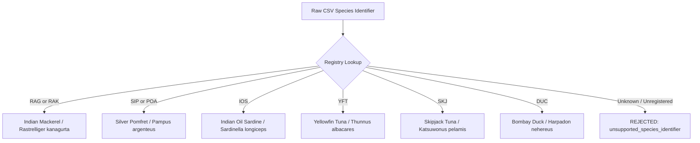

# ORCA Marine Intelligence & Fishing Advisory Platform
## Biological Data Onboarding Readiness Report (v3.2)

**Document Version:** 3.2.0  
**Date of Audit:** 2026-10-13  
**Target Repository:** `D:\orca`  
**Operational Biological Store Status:** `AWAITING_AUTHORIZED_DATA`  
**CMFRI Requisition Package Status:** `DRAFT — PENDING PI SIGNATURE AND SUBMISSION`  
**Predictive Fisheries Model Status:** `NO_TRAINED_MODEL — PREDICTIONS DISABLED`  

---

## 1. Executive Summary & Verification Purpose

The `v3.2` milestone formalizes the institutional and architectural readiness of the ORCA platform for the anticipated onboarding of external ground-truth fisheries datasets from the **ICAR - Central Marine Fisheries Research Institute (CMFRI)**.

### Scientific Safeguards & Non-Fabrication Invariants
1. **Zero Data Fabrication:** No synthetic, simulated, or scraped records are permitted in the operational biological store.
2. **Model Withholding:** No trained machine learning biological prediction model exists. All predictive metrics (`predictive_accuracy = "NOT_EVALUABLE"`) and fish predictions (`catch_probability = None`, `fish_presence = "UNVERIFIED"`, `biomass_prediction = None`) remain strictly disabled.
3. **No Self-Declared Authorization:** In-band CSV assertions (`is_authorized=true`) cannot authorize ingestion. Every imported record requires an independently verifiable, out-of-band `access_authorization_token`.
4. **Draft Integrity:** No requisition request has been dispatched or submitted to ICAR-CMFRI. The requisition package remains an unsubmitted draft requiring manual PI completion.

---

## 2. Schema Verification: Documentation vs. Importer & Quality Gate

A structural audit was conducted comparing the documented ingestion contract against the actual Python implementation:

| Field / Specification | Documented Contract (`CMFRI_DATA_REQUISITION_PACKAGE_v2_8.md`) | Importer Implementation (`ground_truth_import.py`) | Quality Gate (`biological_adapter.py`) | Consistency Assessment |
| :--- | :--- | :--- | :--- | :---: |
| **Mandatory Schema Headers** | Exactly 13 headers required for CSV parsing | `CANONICAL_REQUIRED_COLUMNS` contains exactly 13 items (lines 48–62) | N/A (applied during CSV parsing) | **100% MATCH** |
| **Header Aliases** | Documented standard aliases (`record_id`, `agency`, `lat`, `lon`, `catch_kg`, etc.) | `COLUMN_ALIASES` dict (lines 65–87) maps all documented aliases | N/A | **100% MATCH** |
| **UTF-8 BOM Handling** | Accepts UTF-8 with BOM (`\ufeff`) | Stripped in `_resolve_header_mapping` (line 100) | Handled cleanly | **100% MATCH** |
| **Gate 6 Token Enforcement** | `access_authorization_token` required for authorized commitment | Extracted and passed to `RawBiologicalFisheriesRecord` | Gate 6 rejects records without non-empty external token | **100% MATCH** |
| **Catch Units** | `kg`, `kilogram` | `VALID_CATCH_UNITS = {"kg", "kilogram", "kilograms"}` | Gate 4 validates `catch_weight_kg >= 0.0` | **100% MATCH** |
| **Effort Units** | `hours`, `hour`, `trawl_hours` | `VALID_EFFORT_HOURLY_UNITS = {"hours", "h", "hour", "trawl_hours", "fishing_hours"}` | Gate 4 validates `effort_hours > 0.0` | **100% MATCH** |
| **Spatial Uncertainty** | Default: $5.0\text{ km}$, Max allowable: $50.0\text{ km}$ | Line 377: Default `5.0` | Line 64: `max_spatial_uncertainty_km = 50.0` | **100% MATCH** |
| **CPUE Derivation** | $\text{CPUE} = \text{catch\_kg} / \text{effort\_hours}$ | Line 193: `round(catch_weight_kg / effort_hours, 2)` | Documented & enforced | **100% MATCH** |
| **Atomic Commit & Rollback** | Zero partial commits on batch failure | Importer rolls back mutable signatures on failure | In-memory store untouched on quarantine | **100% MATCH** |

*Conclusion:* The documented schema and the actual codebase implementation are in complete alignment. No code adjustments or schema alterations were necessary.

---

## 3. Outstanding Institutional Fields & Unresolved Blockers

Before the requisition package can be submitted to ICAR-CMFRI, the following institutional items and blockers must be resolved by human researchers:

| Blocker ID | Domain | Description | Current State | Required Action |
| :---: | :--- | :--- | :---: | :--- |
| **B-1** | **Institutional Identity** | PI Name, Designation, Department, and University affiliation placeholders | `PLACEHOLDERS_PRESENT` | PI must replace `[TO BE FILLED BY PI]` placeholders in Lines 142–147 and Lines 275–276 of requisition package. |
| **B-2** | **Official Letterhead & Signature** | Printed formal requisition on university letterhead with manual signature | `NOT_EXECUTED` | Print, sign, and date the letter; transmit physically or via official institutional email. |
| **B-3** | **Data-Sharing Agreement / MoU** | Bilateral legal research MoU between University and ICAR-CMFRI | `NOT_INITIATED` | University administration must initiate formal bilateral data-sharing agreement. |
| **B-4** | **Species Code: Mackerel** | FAO canonical `RAG` vs historical CMFRI `RAK` (*Rastrelliger kanagurta*) | `DUAL_SUPPORTED` | ORCA resolves both codes; CMFRI must confirm which code appears in exported NMFDC files. |
| **B-5** | **Species Code: Pomfret** | FAO canonical `SIP` vs historical CMFRI `POA` (*Pampus argenteus*) | `DUAL_SUPPORTED` | ORCA resolves both codes; CMFRI must confirm which code appears in exported NMFDC files. |
| **B-6** | **Out-of-Band Token Protocol** | Delivery mechanism and lifecycle for `access_authorization_token` | `AWAITING_PROTOCOL` | CMFRI and PI must define token generation, delivery channel, and expiration protocol. |
| **B-7** | **Sampling Effort Resolution** | Trip-level duration in hours vs. monthly aggregates in days fished | `AWAITING_CONFIRMATION` | CMFRI must confirm if trip-level active hours are available or provide fleet conversion multipliers. |
| **B-8** | **Spatial Coordinate Semantics** | Coordinates represent landing jetty vs. fishing ground centroid | `AWAITING_CONFIRMATION` | CMFRI must confirm whether latitude/longitude represent landing center harbor or offshore catch polygon centroid. |

---

## 4. Species Coding & Taxonomic Reconciliation Decisions

ORCA maintains a strict, auditable species registry (`backend/app/agents/species_rules.py`). Decisions regarding the five pilot commercial species are documented as follows:



1. **Indian Mackerel (*Rastrelliger kanagurta*):** Canonical FAO ASFIS code is `RAG`. Older CMFRI bulletins use `RAK`. Both resolve to `mackerel` in ORCA.
2. **Silver Pomfret (*Pampus argenteus*):** Canonical FAO ASFIS code is `SIP`. Older Indian survey literature uses `POA`. Both resolve to `silver_pomfret` in ORCA.
3. **Indian Oil Sardine (*Sardinella longiceps*):** Resolved via canonical code `IOS` or English common name.
4. **Mandatory Tuna Separation:** Yellowfin Tuna (`YFT`) and Skipjack Tuna (`SKJ`) are maintained as separate species. Aggregated "Tuna (General)" entries without species breakdown are quarantined under quality rules.
5. **Bombay Duck (*Harpadon nehereus*):** Supported under code `DUC` for northern West Coast centers (Sasoon Docks, Mirkarwada).

---

## 5. Spatial Semantics & Uncertainty Rules

- **Harbor Landing vs. Offshore Centroid:**
  - If CMFRI exports coordinates of the landing jetty, the offshore uncertainty radius is set to the default of $5.0\text{ km}$ (stored in `metadata["landing_center"]`).
  - If fishing ground coordinates are provided, the centroid is preserved with the documented uncertainty.
- **Uncertainty Bound:** Spatial uncertainty radius cannot exceed $50.0\text{ km}$ (`max_spatial_uncertainty_km`). Any record with uncertainty $> 50.0\text{ km}$ or negative values is quarantined at Gate 2.
- **Five Validated Pilot Centers:**
  1. *Malim Jetty / Panaji, Goa:* $15.5036^\circ\text{N}, 73.8286^\circ\text{E}$
  2. *Mirkarwada / Ratnagiri, Maharashtra:* $16.9902^\circ\text{N}, 73.2847^\circ\text{E}$
  3. *Sasoon Docks / New Ferry Wharf, Mumbai:* $18.9167^\circ\text{N}, 72.8250^\circ\text{E}$
  4. *Baithkol / Karwar, Karnataka:* $14.8055^\circ\text{N}, 74.1244^\circ\text{E}$
  5. *Mangalore Old Port, Karnataka:* $12.8580^\circ\text{N}, 74.8360^\circ\text{E}$

---

## 6. Sampling Effort & CPUE Formulation Rules

- **Catch Units:** Strictly restricted to kilograms (`kg`, `kilogram`). Metric tonnes (`t`) or non-standard local units (e.g. "baskets", "crates") without certified multipliers are rejected.
- **Effort Units:** Strictly restricted to active fishing hours (`hours`, `h`, `trawl_hours`). Trip duration in `days` cannot be directly used without CMFRI fleet conversion factors.
- **CPUE Formulation:**
  $$\text{CPUE} = \frac{\text{catch\_weight\_kg}}{\text{effort\_hours}} \quad (\text{kg/hour})$$
- **Non-Positive & Missing Value Rejection:**
  - Catch weight $< 0.0$, `NaN`, or `Infinity` is rejected.
  - Effort hours $\le 0.0$, `NaN`, or `Infinity` is rejected.
  - Zero-catch trips (valid negative search evidence) must be explicitly flagged by the custodian to be distinguished from omitted data.

---

## 7. Import Pipeline Security & Quality Gate Verification

The six quality gates implemented in [`AuthorizedFisheriesAdapter`](file:///D:/orca/backend/app/data_sources/biological_adapter.py) and [`OfflineGroundTruthImporter`](file:///D:/orca/backend/app/data_sources/ground_truth_import.py) were validated:

```
Gate 1: Species Identification Gate (FAO 3-alpha & binomial validation)
Gate 2: Geographic Coordinate & Spatial Uncertainty Gate (bounds & <= 50km radius)
Gate 3: Temporal Integrity & Freshness Gate (past UTC timestamps, no future dates)
Gate 4: Sampling Effort & Catch Metric Gate (kg, hours, non-negative, CPUE)
Gate 5: Observation Method Separation Gate (Commercial Landing vs Acoustic Survey)
Gate 6: Custodian Authorization Gate (in-band self-assertions rejected; external token required)
```

**Key Invariant:** In-memory store `_normalized_records` is committed **only** when an imported row is marked `is_authorized=True` AND satisfies Gate 6 with an out-of-band token. Unauthorized rows (`is_authorized=False`) receive status `"invalid"` and are never committed. Self-declared authorizations without tokens are quarantined immediately.

---

## 8. Test Execution & Verification Results

The complete onboarding and fisheries hardening test suite was executed:

```powershell
python -m pytest tests/unit/test_fisheries_hardening_v2_8.py tests/unit/test_ground_truth_import_v2_5.py tests/unit/test_ground_truth_import_authorization_mix.py tests/unit/test_fisheries_ingestion.py tests/unit/test_fisheries_adapter_v2_4.py -v
```

**Results:** **65 passed in 0.26s (100% pass rate, 0 failures)**

| Test Module | Coverage Domain | Passed | Failed |
| :--- | :--- | :---: | :---: |
| [`test_fisheries_hardening_v2_8.py`](file:///D:/orca/tests/unit/test_fisheries_hardening_v2_8.py) | Self-declared auth bypass rejection, UTF-8 BOM, numerical bounds | 7 | 0 |
| [`test_ground_truth_import_v2_5.py`](file:///D:/orca/tests/unit/test_ground_truth_import_v2_5.py) | Missing headers, unsupported species, invalid units, dry-run mode | 16 | 0 |
| [`test_ground_truth_import_authorization_mix.py`](file:///D:/orca/tests/unit/test_ground_truth_import_authorization_mix.py) | Mixed auth batches, zero partial commits, token whitespace rejection | 11 | 0 |
| [`test_fisheries_ingestion.py`](file:///D:/orca/tests/unit/test_fisheries_ingestion.py) | INCOIS PFZ and NOAA ERDDAP adapters, resilient worker lifecycle | 21 | 0 |
| [`test_fisheries_adapter_v2_4.py`](file:///D:/orca/tests/unit/test_fisheries_adapter_v2_4.py) | Six quality gates, spatial uncertainty thresholds, method separation | 10 | 0 |
| **TOTAL** | **Onboarding & Biological Quality Verification** | **65** | **0** |

---

## 9. Readiness Sign-off & Next Steps

### Current Classification: **`READY_FOR_ONBOARDING_PENDING_EXTERNAL_DATA`**

1. **Software Pipeline:** Ready for ingestion. The importer, quality gates, and data adapters are fully implemented, verified, and test-covered.
2. **Operational Status:** Operational biological store remains clean (`AWAITING_AUTHORIZED_DATA`). Predictions remain disabled (`fish_presence = "UNVERIFIED"`).
3. **Human Action Required:** Principal Investigator must review [`CMFRI_DATA_REQUISITION_PACKAGE_v2_8.md`](file:///D:/orca/CMFRI_DATA_REQUISITION_PACKAGE_v2_8.md), replace placeholders, execute bilateral MoU with ICAR-CMFRI, and transmit the formal request.
