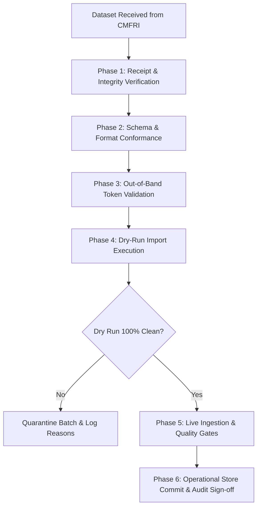

# ORCA Marine Intelligence & Fishing Advisory Platform
## Institutional Data Acquisition Tracker (v3.3)

**Document Version:** 3.3.0  
**Date of Audit:** 2026-10-13  
**Target Repository:** `D:\orca`  
**Operational Biological Store Status:** `AWAITING_AUTHORIZED_DATA`  
**Requisition Package Status:** `DRAFT — PENDING MANUAL PI SIGNATURE & DISPATCH`  
**External Submission Status:** `UNSUBMITTED — NO FORMS TRANSMITTED, NO EMAILS SENT`  
**Biological Model Status:** `NO_TRAINED_MODEL — PREDICTIONS STRICTLY WITHHELD`  

---

## 1. Executive Context & Invariants

This document establishes the official tracking register for external biological ground-truth data acquisition from the **ICAR - Central Marine Fisheries Research Institute (CMFRI)** and associated national data custodians (e.g. Fishery Survey of India).

### Non-Negotiable Invariants:
1. **Unsubmitted Draft Integrity:** Nothing in the requisition package ([`CMFRI_DATA_REQUISITION_PACKAGE_v2_8.md`](file:///D:/orca/CMFRI_DATA_REQUISITION_PACKAGE_v2_8.md)) has been signed, dispatched, or transmitted. No automated communications, web requests, or emails have been initiated.
2. **Safeguards Preserved:** The operational biological store remains clean and empty (`AWAITING_AUTHORIZED_DATA`). In the absence of validated institutional observations:
   - `fish_presence = "UNVERIFIED"`
   - `catch_probability = None`
   - `biomass_prediction = None`
   - `predictive_accuracy = "NOT_EVALUABLE"`
3. **No Credential Fabrication:** Authorization tokens (`access_authorization_token`) are strictly out-of-band custodianship secrets. No tokens or credentials may be invented, hardcoded, or assumed.
4. **Documentation-Only Scope:** This tracker records institutional progress and operational requirements without altering application code, schemas, or authorization gates.

---

## 2. Institutional Blocker Tracking Matrix

The following matrix tracks all outstanding institutional, legal, and methodological requirements needed to acquire, validate, and onboard authentic ground-truth fisheries telemetry.

| Blocker ID | Domain | Description | Current Status | Responsible Party | Required Verification Evidence | Next Action | Target Date |
| :---: | :--- | :--- | :---: | :--- | :--- | :--- | :---: |
| **B-1** | **PI Contact Details** | Placeholder replacement in formal requisition draft (`[TO BE FILLED BY PI]`). | `PENDING_PI_ACTION` | Project Principal Investigator (PI) | Verified legal name, official academic designation, university/institute affiliation, `.edu` / `.ac.in` / `.res.in` email, and institutional phone number inserted into Lines 142–147 and 275–276 of `CMFRI_DATA_REQUISITION_PACKAGE_v2_8.md`. | PI fills contact details in requisition package. | `PENDING_PI_REVIEW` |
| **B-2** | **Institutional Signature** | Formal requisition printed on university letterhead with manual PI endorsement. | `PENDING_PI_SIGNATURE` | Project PI & Department Head | Signed and stamped physical or digital PDF requisition letter carrying institutional seal and letterhead dispatch reference number. | Print on university letterhead, sign, date, and obtain institutional endorsement. | `PENDING_PI_DISPATCH` |
| **B-3** | **Data-Sharing Agreement / MoU** | Bilateral legal research agreement governing non-commercial academic use. | `PENDING_LEGAL_INITIATION` | University Administration & CMFRI Legal Cell | Executed Memorandum of Understanding (MoU) or formal Data-Sharing Agreement signed by authorized institutional signatories of both entities. | University registrar / legal cell initiates data-sharing agreement request with CMFRI Kochi. | `PENDING_BILATERAL_MOU` |
| **B-4** | **Species Code: Mackerel** | Discrepancy between canonical FAO code `RAG` and historical CMFRI code `RAK` (*Rastrelliger kanagurta*). | `DUAL_SUPPORTED_AWAITING_CONFIRMATION` | CMFRI Data Custodian (FRAEED / NMFDC) | Official CMFRI data dictionary or email confirmation confirming which 3-alpha code is exported in the 2023–2025 dataset. | Transmit formal inquiry accompanying requisition letter (§5.2). | `PENDING_CMFRI_RESPONSE` |
| **B-5** | **Species Code: Pomfret & Tuna** | Discrepancy between FAO `SIP` and historical `POA` (*Pampus argenteus*); verification of separate `YFT` and `SKJ` lines. | `DUAL_SUPPORTED_AWAITING_CONFIRMATION` | CMFRI Data Custodian (FRAEED / NMFDC) | Written confirmation of Pomfret code and verification that Yellowfin and Skipjack Tuna are reported as separate line items rather than grouped. | Transmit formal inquiry accompanying requisition letter (§5.2). | `PENDING_CMFRI_RESPONSE` |
| **B-6** | **External Authorization Token** | Issuance protocol, lifecycle, and delivery mechanism for Gate 6 ingestion token. | `AWAITING_PROTOCOL_DEFINITION` | CMFRI Data Custodian & ORCA System Custodian | Documented delivery protocol (e.g. encrypted email, secure portal) and issuance of a valid alphanumeric batch token with documented validity and revocation policy. | Define token delivery protocol in bilateral agreement; receive out-of-band credential from CMFRI. | `PENDING_DATA_APPROVAL` |
| **B-7** | **Sampling Effort Resolution** | Temporal granularity (individual haul duration in active hours vs. monthly harbor aggregate days). | `AWAITING_METHODOLOGY_CONFIRMATION` | CMFRI FRAEED Division | Methodological statement confirming whether trip-level active fishing hours are supplied, or providing standardized fleet conversion multipliers for monthly aggregate records. | Transmit formal methodological inquiry (§5.3). | `PENDING_CMFRI_RESPONSE` |
| **B-8** | **Spatial Coordinate Semantics** | Semantic definition of coordinates (landing jetty coordinates vs. offshore fishing ground centroid). | `AWAITING_GEOGRAPHIC_CONFIRMATION` | CMFRI FRAEED Division | Clarification note stating whether exported coordinates represent the harbor landing center or the offshore catch polygon centroid. | Transmit formal geographical inquiry (§5.4). | `PENDING_CMFRI_RESPONSE` |

---

## 3. Pre-Transmission Submission Checklist

Before the Principal Investigator prints, signs, and dispatches the requisition package to ICAR-CMFRI, each checklist item must be systematically confirmed:

- [ ] **1. Institutional Letterhead:** Requisition text transferred to official university / institute letterhead.
- [ ] **2. PI Identification Complete:** All 8 placeholder fields (`[TO BE FILLED BY PI]`) in Lines 142–147 and 275–276 of `CMFRI_DATA_REQUISITION_PACKAGE_v2_8.md` are populated with genuine contact info.
- [ ] **3. Pilot Center Scope Verified:** Five landing centers confirmed (Malim, Mirkarwada, Sasoon Docks, Baithkol, Mangalore Old Port).
- [ ] **4. Target Species Listed:** Five priority commercial species documented with dual-code recognition (`RAG`/`RAK`, `SIP`/`POA`, `IOS`, `YFT`, `SKJ`).
- [ ] **5. Temporal Scope Specified:** Calendar years 2023–2025 requested at trip-level resolution.
- [ ] **6. Ingestion Schema Attached:** Technical Annexure (§3) detailing the 13 canonical CSV headers and Gate 6 token requirement attached to request.
- [ ] **7. Methodological Inquiries Included:** Formal questions regarding gear standardization, aggregate effort multipliers, and coordinate semantics appended.
- [ ] **8. Data Anonymization Undertaking Included:** Legal commitment to anonymize Vessel Registration Numbers (VRNs) and crew identities affirmed.
- [ ] **9. Manual Signature & Date:** Principal Investigator signature and official stamp applied.
- [ ] **10. Dispatch Logged:** Dispatch tracking number or registered post receipt recorded in institutional records.

---

## 4. Authorized-Data Receipt & Ingestion Checklist

When ICAR-CMFRI formally approves the requisition and transmits the external dataset, the ORCA Technical Custodian must follow this strict verification sequence before any data enters the operational system:

### Phase 1: Physical / Digital Receipt Verification
- [ ] **1.1 Custodian Provenance:** Verify sender address matches official institutional domain (`director.cmfri@icar.gov.in` or `fraeed.cmfri@icar.gov.in`).
- [ ] **1.2 Cryptographic Checksum:** Calculate SHA-256 hash of incoming CSV immediately upon receipt and log in custody register.
- [ ] **1.3 Formal Release Memo:** Confirm accompanying formal release letter, memo, or licensing endorsement from ICAR-CMFRI.

### Phase 2: Schema & Format Integrity
- [ ] **2.1 Canonical Header Conformance:** Verify all 13 canonical headers (`CANONICAL_REQUIRED_COLUMNS`) are present via `_resolve_header_mapping`.
- [ ] **2.2 Encoding Integrity:** Verify UTF-8 encoding (with or without BOM) and CRLF/LF line termination.
- [ ] **2.3 Unit Standardization:** Verify catch values are reported in `kg` and effort values in `hours` (or apply CMFRI-certified conversion multipliers).

### Phase 3: Out-of-Band Token Validation
- [ ] **3.1 Token Presence:** Confirm non-empty `access_authorization_token` supplied out-of-band by CMFRI/PI.
- [ ] **3.2 Whitespace & Bypass Rejection:** Verify token is non-whitespace and matches authorized batch scope.
- [ ] **3.3 Secret Scrubbing:** Ensure token is never written to disk logs, client responses, or persisted in `EvidenceRecord.metadata`.

### Phase 4: Dry-Run Import Execution
- [ ] **4.1 Dry-Run Invocation:** Execute `OfflineGroundTruthImporter.parse_csv_stream(..., is_dry_run=True)`.
- [ ] **4.2 Zero Store Mutation:** Assert `len(adapter._normalized_records)` remains unchanged before and after dry run.
- [ ] **4.3 Quarantine Inspection:** Review tally of quarantined rows and inspect reason counter for schema divergences.

### Phase 5: Live Ingestion & Quality Gate Validation
- [ ] **5.1 Gate 1 (Species):** All species resolve against ORCA canonical registry; unsupported codes quarantined.
- [ ] **5.2 Gate 2 (Spatial):** All coordinates within $[-90, 90]$ and $[-180, 180]$; spatial uncertainty $\le 50.0\text{ km}$.
- [ ] **5.3 Gate 3 (Temporal):** Timestamps in ISO 8601 UTC/IST; future-dated records strictly rejected.
- [ ] **5.4 Gate 4 (Effort/Catch):** Catch $\ge 0.0\text{ kg}$; effort $> 0.0\text{ hours}$; CPUE calculated correctly.
- [ ] **5.5 Gate 5 (Method):** Observation method classified as `COMMERCIAL_LANDING_STATISTIC`.
- [ ] **5.6 Gate 6 (Authorization):** In-band `is_authorized=True` corroborated by valid external token.

### Phase 6: Operational Store Commitment & Benchmark Audit
- [ ] **6.1 Atomic Commit:** Execute live import (`is_dry_run=False`); verify atomic commit of valid records.
- [ ] **6.2 SHA-256 Deduplication:** Verify file checksum added to `imported_file_checksums` to prevent duplicate re-ingestion.
- [ ] **6.3 Store Status Transition:** Formally transition store status from `AWAITING_AUTHORIZED_DATA` to `AUTHORIZED_DATA_ONBOARDED`.
- [ ] **6.4 Benchmark Partitioning:** Generate strict temporal splits for evaluation without cross-partition leakage.

---

## 5. Summary of System Status

| Component | Status | Operational Consequence |
| :--- | :---: | :--- |
| **Operational Biological Store** | **`AWAITING_AUTHORIZED_DATA`** | Contains zero unverified or synthetic biological records. |
| **Fish Presence Telemetry** | **`UNVERIFIED`** | Biological presence remains explicitly unverified across all agents. |
| **Catch Probability** | **`null`** | No numerical catch probabilities are generated or predicted. |
| **Biomass Prediction** | **`None`** | Direct pelagic biomass predictions remain unavailable. |
| **Predictive Accuracy Metrics** | **`NOT_EVALUABLE`** | Precision, Recall, and F1 benchmarks remain strictly withheld. |
| **Environmental Suitability** | **`HEURISTIC_ONLY`** | Wave feasibility evaluated strictly as physical vessel operability. |
| **Institutional Requisition** | **`DRAFT_PENDING_ACTION`** | Package prepared, audited, and held for human PI review and dispatch. |
