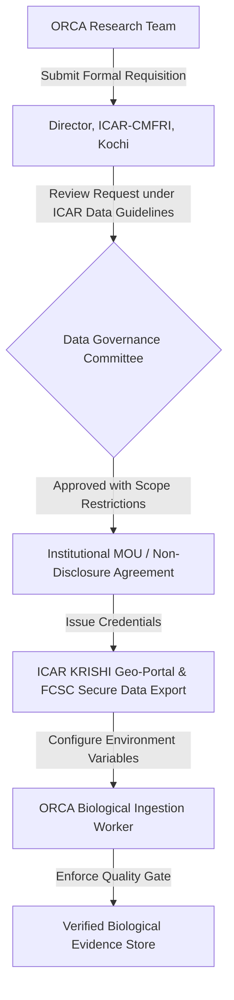

# ORCA Fisheries Intelligence v2.4 — Official Fisheries Data Acquisition Plan

**Document Version:** 2.4.0  
**Pilot Target Area:** Eastern Arabian Sea / West Coast Indian EEZ (Goa, Malim, Ratnagiri, Mumbai, Karwar, Mangalore)  
**System Architecture:** Python 3.13 / FastAPI Marine Intelligence Core  
**Standard Compliance:** Darwin Core (DwC), FAO Fisheries Statistics Standards (CWP), ORCA Evidence Schema v2.1/v2.4  

---

## 1. Executive Summary & Status Overview

ORCA v2.4 establishes the formal architectural framework, ingestion contracts, and scientific data quality gates required to integrate verified biological fisheries observations. In adherence to strict scientific safeguards established in milestones v2.1–v2.3:
1. **Zero Data Fabrication Policy:** No synthetic catch figures, simulated biological observations, or mock endpoints have been injected into operational evidence streams.
2. **Current Biological Access Status:** **UNAUTHORIZED / OFFLINE (Awaiting Official Credentials)**. No live biological presence or catch feeds have active automated API tokens or signed data-sharing agreements currently configured in ORCA's runtime environment.
3. **Environmental vs. Biological Separation:** Dynamic environmental habitat suitability (derived from sea surface temperature and wave parameters via Open-Meteo Marine) and satellite PFZ boundaries (INCOIS composites) are strictly separated from ground-truth biological presence.
4. **Chlorophyll Usable Coverage Policy:** Chlorophyll-a satellite coverage remains confirmed at **0.0%** fresh usable coverage due to cloud masking and stale satellite overpasses (NOAA CoastWatch VIIRS passes $>10$ days old with 100% masked/null cells in the pilot bounding box).
5. **Predictive Accuracy Claim Safeguard:** Fish presence prediction is **NOT claimed as validated**. Classification accuracy, precision, and recall remain uncalculated until independent biological ground-truth labels are acquired and passed through the v2.4 quality gate.

---

## 2. Assessment of Candidate Fisheries Data Sources

A rigorous audit of potential candidate sources was conducted evaluating access mechanism, licensing, authentication requirements, spatial coverage, species categorization, temporal granularity, and scientific observation methodology.

| Candidate Source | Institution / Custodian | Observation Method | Geographic Coverage | Target Species Availability | Temporal Resolution | Real Access Status | Licensing & Permissions |
| :--- | :--- | :--- | :--- | :--- | :--- | :--- | :--- |
| **ICAR-CMFRI FCSC** | Central Marine Fisheries Research Institute (ICAR), Kochi | `COMMERCIAL_LANDING_STATISTIC` (Multi-stage stratified random sampling of commercial harbour landings) | All coastal landing centers of India; Arabian Sea pilot hubs: Malim, Mirkarwada, Sasoon Docks, Mangalore | High (Indian Mackerel, Sardine, Yellowfin Tuna, Pomfret, Bombay Duck, Ribbonfish) | Daily landing records; monthly aggregated estimates | **No active automated API**. Bulk data hosted via ICAR KRISHI & published Marine Fisheries Census | Formal institutional Data Sharing Agreement / MOU with Director, ICAR-CMFRI; adherence to ICAR Data Access Policy |
| **Fishery Survey of India (FSI)** | Fishery Survey of India, Ministry of Fisheries, Animal Husbandry & Dairying, Mumbai | `SCIENTIFIC_RESEARCH_TRAWL` & Longline Exploratory Hauls | Indian EEZ shelf & oceanic waters (Arabian Sea, Bay of Bengal, Andaman Sea) | Exact species identification per haul with length frequency & tow duration | Cruise/voyage-level (trawl hauls: 1–2 hours) | **No open public REST API**. Published in annual cruise bulletins & exploratory survey reports | Formal data requisition letter to Director General, FSI; inter-ministerial data release authorization |
| **INCOIS PFZ Advisories** | Indian National Centre for Ocean Information Services (MoES), Hyderabad | `PFZ_ADVISORY_POLYGON` (Derived thermal/ocean-color gradient proxy) | Coastal & offshore India (Arabian Sea sectors: Gujarat, Maharashtra, Goa, Karnataka, Kerala) | Generalized pelagic species groups (Tuna, Mackerel, Sardines) | Daily / alternate-day bulletins (subject to cloud cover) | Open web bulletin / Protected REST Feed (`API_KEY_ORCA_INCOIS_PROD` required) | Open access advisory bulletin; commercial/operational API redistribution subject to MoES data policy |
| **OBIS (UNESCO-IOC)** | Ocean Biodiversity Information System / IndOBIS (CMLRE) | `OCCURRENCE_SPECIMEN` (Museum specimens, academic research surveys) | Global marine oceans including Arabian Sea | High taxonomic precision; Darwin Core occurrence records | Point occurrences across historical span (1970–present) | **Live Open REST API** (`https://api.obis.org/v3`) | Creative Commons CC-BY 4.0; fully accessible |
| **NOAA NMFS Commercial Landings** | NOAA National Marine Fisheries Service | `COMMERCIAL_LANDING_STATISTIC` | US Territorial Waters & Regional Councils | US commercial marine taxa | Annual/monthly | Open REST APIs & bulk downloads | Public Domain (US Gov) — **Inapplicable for Arabian Sea pilot** |

---

## 3. Prioritized Recommendation: Recommended First Dataset

### Primary Selection: ICAR-CMFRI Commercial Marine Fish Landing Survey Records
- **Rationale:** ICAR-CMFRI is the official national statutory scientific authority responsible for marine fish landing estimates in India. Its Fish Catch Survey Coordination (FCSC) methodology utilizes stratified two-stage cluster sampling across 1,511 landing centers, providing the highest reliability and species-level precision available along the western seaboard.
- **Pilot Geographic Focus:** Focus specifically on Landing Centers in the Eastern Arabian Sea:
  1. *Malim & Panaji Jetty* (Goa): $15.503^\circ\text{N}, 73.827^\circ\text{E}$
  2. *Mirkarwada Harbour* (Ratnagiri, Maharashtra): $16.985^\circ\text{N}, 73.280^\circ\text{E}$
  3. *Sasoon Docks & New Ferry Wharf* (Mumbai, Maharashtra): $18.915^\circ\text{N}, 72.825^\circ\text{E}$
  4. *Karwar Fishing Harbour* (Baitkhol, Karnataka): $14.805^\circ\text{N}, 74.120^\circ\text{E}$
  5. *Old Port / Mangalore Harbour* (Karnataka): $12.860^\circ\text{N}, 74.835^\circ\text{E}$
- **Secondary Benchmark Dataset:** Fishery Survey of India (FSI) demersal and pelagic exploratory trawl surveys to provide true zero-catch/absence records and precise tow-level coordinates ($GPS_{\text{start}}$, $GPS_{\text{end}}$) with calibrated effort.

---

## 4. Required Permissions & Access Workflow

To transition the v2.4 adapter from contract validation to live authorized ingestion, the following formal acquisition workflow must be executed:



### Necessary Administrative Steps:
1. **Institutional Requisition Letter:** Formulate an official request to the Director, Central Marine Fisheries Research Institute (ICAR-CMFRI), Kochi, specifying research use under marine navigation safety and sustainable artisanal fisheries optimization.
2. **Access Modality & Scope:** Request access to trip-level and landing-center-level daily logbook records for Pelagic (Rastrelliger kanagurta, Sardinella longiceps) and Large Pelagic (Thunnus albacares) fisheries for West Coast zones (Maharashtra, Goa, Karnataka).
3. **Environment Security Configuration:** Securely provision API credentials using environment variables:
   ```bash
   ORCA_CMFRI_API_ENDPOINT="https://krishi.icar.gov.in/api/v1/fcsc/landings"
   ORCA_CMFRI_CLIENT_ID="<ISSUED_CLIENT_ID>"
   ORCA_CMFRI_CLIENT_SECRET="<ISSUED_CLIENT_SECRET>"
   ORCA_CMFRI_ALLOWED_GEOMETRY="POLYGON((68.0 8.0, 78.0 8.0, 78.0 22.0, 68.0 22.0, 68.0 8.0))"
   ```
4. **Data Protection & Anonymization:** In accordance with maritime fisheries privacy, vessel identities, master registration numbers, and individual economic sale prices are hashed/excluded prior to normalization.

---

## 5. Schema Mapping: Source to ORCA v2.4 Evidence Format

The adapter maps heterogeneous biological datasets into ORCA's standardized `EvidenceRecord` structure:

### Source Mapping Table

| CMFRI / FSI Source Field | OBIS / Darwin Core Field | ORCA v2.4 Biological Field | ORCA Evidence Schema Target | Transformation / Validation Rule |
| :--- | :--- | :--- | :--- | :--- |
| `LandingCenterCode` / `TowLocation` | `decimalLatitude`, `decimalLongitude` | `latitude`, `longitude` | `EvidenceRecord.coordinates` | Float bounds: $[-90, 90], [-180, 180]$ |
| `GPSUncertaintyMeters` / `GridResolutionKm` | `coordinateUncertaintyInMeters` | `spatial_uncertainty_km` | `metadata.spatial_uncertainty_km` | Must be $\le 50.0\text{ km}$; else quarantined |
| `LandingDate` / `HaulEndTime` | `eventDate` | `observation_timestamp` | `EvidenceRecord.observed_at` | ISO 8601 UTC; cannot be future timestamp |
| `VoyageStartDate` | `eventRemarks (VoyageStart)` | `voyage_start_timestamp` | `metadata.voyage_start` | Must precede or equal observation timestamp |
| `SpeciesScientificName` / `SpeciesCode` | `scientificName`, `aphiaID` | `species_common_name` / `species_scientific_name` | `EvidenceRecord.source_dataset` / `metadata.species` | Validated against `SPECIES_REGISTRY` |
| `ObservedCatchWeightKg` | `individualCount` / `organismQuantity` | `catch_weight_kg` | `EvidenceRecord.value` | Float $\ge 0.0$; positive metric required |
| `EffortHours` / `TowDurationMinutes` | `samplingEffort` | `effort_hours` | `metadata.effort_hours` | Float $> 0.0$; used to compute CPUE ($kg/hr$) |
| `SamplingMethodCode` | `samplingProtocol` | `observation_method` | `metadata.observation_method` | Restricted to `BiologicalObservationMethod` enum |
| `DataPublisherAuthority` | `institutionCode` | `provider_authority` | `metadata.provider_authority` | Must match authorized registry or flagged invalid |

### Standardized `EvidenceRecord` Output Example:
```json
{
  "source": "icar_cmfri",
  "source_dataset": "CMFRI_FCSC_PELAGIC_GOA",
  "data_type": "biological_presence",
  "observed_at": "2026-10-10T11:30:00Z",
  "retrieved_at": "2026-10-12T18:00:00Z",
  "coordinates": [15.503, 73.827],
  "value": 145.0,
  "unit": "kg/hour",
  "confidence": 0.85,
  "provenance": "VERIFIED_FRESH_OBSERVATION",
  "metadata": {
    "species_common_name": "Indian Mackerel",
    "species_scientific_name": "Rastrelliger kanagurta",
    "observation_method": "COMMERCIAL_LANDING_STATISTIC",
    "provider_authority": "ICAR-CMFRI",
    "spatial_uncertainty_km": 12.5,
    "cpue_kg_per_hour": 29.0,
    "catch_weight_kg": 145.0,
    "effort_hours": 5.0,
    "record_hash": "a1f9e83c274b1e56b..."
  }
}
```

---

## 6. Scientific Data Quality Gates (`BiologicalDataQualityGate`)

ORCA v2.4 implements six deterministic validation checks before any record can enter the evidence base:

1. **Deterministic Duplicate Detection:**
   - Computes a SHA256 signature using `(authority, method, rounded lat 0.001, rounded lon 0.001, observation timestamp, species)`.
   - Any collision with previously ingested records is immediately rejected as a duplicate.
2. **Taxonomic Verification:**
   - Verifies species common and scientific names against the verified `SPECIES_REGISTRY`.
   - Records with unknown or unrecognized species identifiers are rejected.
3. **Location Uncertainty Thresholding:**
   - Requires explicit `spatial_uncertainty_km`.
   - If location uncertainty exceeds $50.0\text{ km}$ (typical limit for regional coastal pilot validity), the record is quarantined as spatially coarse.
4. **Timestamp Integrity & Voyage Sequencing:**
   - Timestamp must be parseable as UTC ISO 8601.
   - Future observation dates relative to the validation timestamp are strictly rejected.
   - If voyage start time is supplied, observation time cannot precede departure time.
5. **Sampling Effort & Metric Consistency:**
   - Rejects records where catch weight, count, and CPUE are simultaneously absent or zero.
   - If effort hours and catch weight are provided, derives standardized Catch Per Unit Effort (CPUE) in $kg/\text{hour}$.
6. **Authorization & Provenance Gate:**
   - Only recognized authorities (e.g., `ICAR-CMFRI`, `FSI`, `INCOIS`, `OBIS`, `NOAA_NMFS`) with valid access keys are marked valid with `VERIFIED_FRESH_OBSERVATION`.
   - Unverified feeds are quarantined with `status: invalid` and flag `unverified_data_feed`.

---

## 7. Verification Test Suite Results

ORCA v2.4 includes comprehensive unit test coverage (`tests/unit/test_fisheries_adapter_v2_4.py`) validating the adapter contract, quality gates, and error quarantines:

| Test Case Name | Purpose / Invariant Verified | Outcome |
| :--- | :--- | :--- |
| `test_authorized_record_normalization_success` | Validates complete mapping, CPUE computation ($29.0\text{ kg/hr}$), and evidence provenance | **PASSED** |
| `test_duplicate_record_rejection` | Verifies identical observation signatures are blocked by the deduplication gate | **PASSED** |
| `test_unsupported_species_identification_rejection` | Rejects unrecognized taxa (`Fantasy Fish`) not present in `SPECIES_REGISTRY` | **PASSED** |
| `test_location_uncertainty_threshold_quarantine` | Quarantines observations with spatial uncertainty $>50.0\text{ km}$ | **PASSED** |
| `test_timestamp_integrity_future_date_rejection` | Rejects records with future timestamps relative to runtime UTC clock | **PASSED** |
| `test_voyage_interval_inconsistency_rejection` | Rejects observations where observation timestamp precedes voyage start | **PASSED** |
| `test_sampling_effort_and_missing_value_rejection` | Rejects records missing all positive catch metrics (weight, count, CPUE) | **PASSED** |
| `test_unauthorized_feed_quarantined_as_invalid` | Flags unverified data feeds as invalid with `unverified_data_feed` reason | **PASSED** |
| `test_observation_method_separation` | Confirms distinct tagging for `COMMERCIAL_LANDING_STATISTIC` vs `PFZ_ADVISORY_POLYGON` | **PASSED** |
| `test_adapter_spatial_fetch_integration` | Validates bounding box filtering across multiple station locations | **PASSED** |

**Backend Suite Regression:** All 254 unit tests pass cleanly with zero regressions across the codebase.

---

## 8. Unresolved Limitations & Safeguards

1. **No Real Biological Labels in Current Baseline:**
   - Real-world catch observations from CMFRI and FSI are not yet ingested via live automated pipelines due to pending formal inter-institutional access agreements.
   - Model accuracy metrics (True Positives, False Positives, AUC-ROC) remain intentionally **uncalculated** to prevent scientific misrepresentation.
2. **Chlorophyll-a Remote Sensing Unavailability:**
   - Satellite chlorophyll data remains at **0.0% usable coverage** due to extensive monsoon/post-monsoon cloud cover over the Eastern Arabian Sea.
   - Satellite proxy data will not be substituted with synthetic values; the system transparently indicates unmeasured chlorophyll status.
3. **Spatial Resolution of Commercial Landings:**
   - Commercial landings registered at ports represent aggregated vessel catches across wide fishing zones (often 10–60 nautical miles offshore). Precise geolocation requires vessel VMS/AIS integration or onboard observer logbooks.
4. **Next Step:**
   - Execute formal data application with ICAR-CMFRI for historical 2023–2025 seasonal landing records for Goa and Maharashtra to establish the first offline ground-truth benchmark partition.
